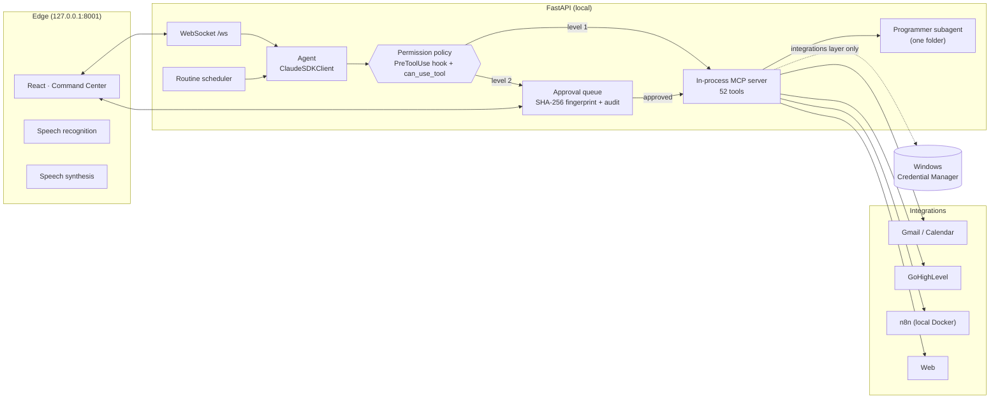

<p align="center">
  
</p>

<h1 align="center">BAKI</h1>

<p align="center">
  <b>Personal AI assistant for Windows, by voice and text, that does not just answer: it acts.</b><br>
  Manages files, email, calendar and CRM, builds n8n automations and writes software projects,<br>
  always under a permission system that asks for your approval before any action with consequences.
</p>

<p align="center">
  
  
  
  
  
  
</p>

---

## What it is

BAKI is a desktop AI agent inspired by the idea of "JARVIS", designed with security at its core. Its brain is the **Claude Agent SDK** (Claude Code running headless). It works with a Claude subscription, **no API key needed**.

You talk to it ("Baki, what's on my calendar today?") or type to it. It chains real tools to carry out the order: it searches the internet, reads your email, builds an n8n workflow, writes code and tests it… When an action sends, publishes, deletes or runs something, it stops and shows you **exactly** what it is about to do before continuing.

## Features

| Area | What it does |
|---|---|
| 🗣️ **Voice** | Hands-free with a wake word ("Baki, …"), voice interruption, echo filter, spoken approval ("yes", "yes to all", "no"). Only answers out loud if the request was spoken. Browser voice, ElevenLabs or a local TTS server. |
| 📁 **Files & system** | Read (text, code, Word, PDF), search, create, edit with backup, move, send to the recycle bin, open apps and websites, PowerShell, clipboard. |
| 🌐 **Web** | Web search and data extraction from pages (emails, phone numbers, links) with SSRF protection. |
| ✉️ **Google Workspace** | Gmail (search, read, drafts, send, trash) and Google Calendar (view, create, edit, delete) through your own OAuth. |
| 📇 **GoHighLevel CRM** | Contacts, opportunities, conversations (SMS, email, Instagram, WhatsApp), social media posting and full API access. |
| ⚙️ **n8n** | Designs, creates, tests (via webhook), debugs and activates automations and AI agents in n8n. |
| 👨‍💻 **Programmer** | A Claude Code subagent confined to one project folder: writes code and tests, runs commands with approval and reviews its own work. |
| 🧠 **Memory** | Long-term memory in an Obsidian vault. Conversations resume after a restart and can be opened and renamed. |
| ⏰ **Routines** | Scheduled tasks (for example, a daily email and calendar digest) in read-only mode, with a report when finished. |
| 🧩 **Skills** | 24 workflow skills: new project, idea refinement, plan interrogation (grill me), specification, planning, TDD, security, debugging, business agents, n8n, plus a business-validation pack (board, competitors, simulated customer panel, pricing, offer, numbers and business plan). |

### "Command Center" interface

- **Center:** streaming chat, safe Markdown and a model selector.
- **Left:** menu with Dashboard, Conversations, Tasks, Skills and Connectors.
- **Right:** Claude usage (conversation context, plan limit, daily consumption) and the conversation's tasks with their status (in progress, done, error).
- **Bottom:** "Talk to BAKI" button and hands-free mode.
- **Approvals:** cards with the exact arguments and approve / reject buttons.

## Architecture



## Security model

Security is the central design decision, not an add-on:

- **Two levels and deny by default.**
  - Level 1 (query, read inside trusted folders) runs without asking.
  - Level 2 (send, publish, delete, overwrite, execute) waits for your approval.
  - Any tool outside the policy is denied.
- **Two independent barriers.** A `PreToolUse` hook, which always runs, and `can_use_tool` evaluate the policy again. Approval is bound to the exact arguments through a SHA-256 fingerprint, is single-use, expires and is audited.
- **Agent isolation.** It starts with `setting_sources=[]`: it loads no `settings.json`, `CLAUDE.md` or hook from disk. Claude Code's built-in tools are disabled (except web search), and the skills arrive as a protected local plugin.
- **Protected zones.** The agent cannot modify its own code, its configuration, its skills, `~/.ssh`, `~/.claude`, Windows credentials or `C:\Windows`. It also cannot extend its own permissions.
- **Secrets out of the model's reach.** They are stored in the Windows Credential Manager (keyring), entered only through the console with hidden input, and never appear in prompts, logs or the audit trail. A test checks that only the integrations layer can read them.
- **Prompt injection.** The content of emails, websites and files is treated as data, not as orders.
- **Local network.**
  - The backend listens only on `127.0.0.1` and validates `Host` and `Origin`, which protects it from DNS rebinding.
  - Web reading blocks private addresses, the local network and cloud metadata.
- **Programmer subagent.**
  - Reads and writes only inside its folder.
  - Every command asks for approval.
  - It does not load the `.claude` configuration of the repository it works on.
- **Routines.** They run in read-only mode. Whatever would require approval is noted in the report instead of being executed.

## Stack

- **Backend:** Python 3.11, FastAPI, Uvicorn, Claude Agent SDK, httpx, keyring, Google API Client, pypdf, Send2Trash.
- **Frontend:** React 19, TypeScript, Vite and custom CSS, no component libraries.
- **Voice:** Web Speech API, ElevenLabs (optional) and a local OpenAI-compatible TTS server (optional).
- **Automation:** n8n on Docker.
- **Memory:** Obsidian (Markdown).

## Project structure

```
BAKI/
├── backend/
│   ├── app/
│   │   ├── main.py              # FastAPI: WebSocket, panels, TTS, interface
│   │   ├── agente/              # session, policy, approvals, logging, protected paths
│   │   │   └── herramientas/    # files, system, web, memory, google, ghl, n8n, routines, programmer
│   │   ├── integraciones/       # only layer with access to secrets
│   │   └── secrets_store.py / secrets_cli.py
│   ├── data/plugin_baki/skills/ # skills BAKI uses at runtime
│   └── tests/                   # 157 tests
├── frontend/src/                # useBaki.ts (logic) + components/ (interface)
├── n8n/docker-compose.yml       # local n8n, reachable only from 127.0.0.1
├── docs/                        # secrets design, status and connection guide (Spanish)
├── iniciar_baki.ps1 / apagar_baki.ps1
└── GUIA_SKILLS.md
```

## Getting started

**Requirements:** Windows 10/11, Python 3.11+, Node.js 24+, [Claude Code](https://docs.claude.com/en/docs/claude-code) installed and signed in, and Microsoft Edge (recommended for its natural-sounding Spanish voices). Docker Desktop for n8n.

```powershell
git clone https://github.com/Javierpe10/Baki.git
cd Baki
python -m venv .venv
.\.venv\Scripts\python.exe -m pip install -r backend\requirements.txt
cd frontend; npm install; npm run build; cd ..
powershell -ExecutionPolicy Bypass -File .\iniciar_baki.ps1
```

`iniciar_baki.ps1` starts the backend hidden, turns on Docker (n8n) if needed and opens BAKI in an Edge window.

**Integrations (optional).** They are connected from the console and the keys go to the Windows Credential Manager:

```powershell
cd backend
..\.venv\Scripts\python.exe -m app.secrets_cli autorizar-google "path\to\client_secret.json"
..\.venv\Scripts\python.exe -m app.secrets_cli conectar-ghl
..\.venv\Scripts\python.exe -m app.secrets_cli conectar-n8n
..\.venv\Scripts\python.exe -m app.secrets_cli conectar-elevenlabs
```

The detailed guide is in [docs/GUIA_CONEXIONES.md](docs/GUIA_CONEXIONES.md) (in Spanish).

**n8n:**

```powershell
cd n8n; docker compose up -d   # http://localhost:5678
```

## Tests

```powershell
cd backend
..\.venv\Scripts\python.exe -m pytest tests -q
```

They cover the permission policy (every tool and level), approvals (single use, expiry, group approval), protected paths and the `..` escape, SSRF protection, secrets isolation, the programmer subagent, n8n flow validation, routines, the endpoints and `Host` / `Origin` validation.

## Third-party skills

Included with their MIT license in each folder:

- [mattpocock/skills](https://github.com/mattpocock/skills): tdd, grill-me, grilling, codebase-design.
- [vercel-labs/skills](https://github.com/vercel-labs/skills): find-skills.
- [addyosmani/agent-skills](https://github.com/addyosmani/agent-skills): idea-refine, spec-driven-development, planning-and-task-breakdown, security-and-hardening, debugging-and-error-recovery.
- [jakeschincariol/founder-skill](https://github.com/jakeschincariol/founder-skill): the 11 founder-* skills (board, competitors, customer panel, pricing, offer, CFO, marketing, brand, operations, launch and plan).

`proyecto-nuevo`, `n8n-automatizacion` and `agente-empresa` are BAKI's own skills.

## Known limitations

- Windows only: it uses the Credential Manager, PowerShell and the Edge path.
- Speech recognition depends on the browser (Edge or Chrome) and needs an internet connection.
- The Claude plan usage limit is only shown when Claude reports it.
- Designed for a single user on their own machine: it does not protect against malicious local processes.

---

<p align="center">Personal project by <b>Javier</b> · built with Claude Code</p>
