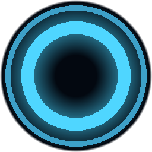
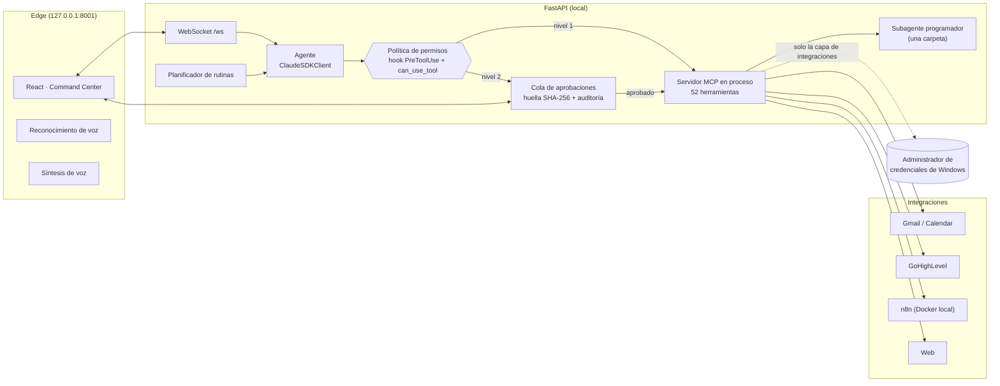

<p align="center">
  
</p>

<h1 align="center">BAKI</h1>

<p align="center">
  <b>Asistente personal de IA para Windows, por voz y por texto, que no solo responde: actúa.</b><br>
  Gestiona archivos, correo, agenda y CRM, crea automatizaciones en n8n y programa proyectos,<br>
  siempre bajo un sistema de permisos que pide tu aprobación antes de cualquier acción con consecuencias.
</p>

<p align="center">
  
  
  
  
  
  
</p>

---

## Qué es

BAKI es un agente de IA de escritorio inspirado en la idea de «JARVIS», diseñado con la seguridad en el centro. Su cerebro es el **Claude Agent SDK** (Claude Code ejecutándose sin interfaz). Funciona con una suscripción de Claude, **sin API key**.

Le hablas («Baki, ¿qué tengo hoy en la agenda?») o le escribes. Encadena herramientas reales para cumplir la orden: busca en internet, lee tus correos, crea un flujo en n8n, escribe código y lo prueba… Cuando una acción envía, publica, borra o ejecuta algo, se detiene y te muestra **exactamente** qué va a hacer antes de seguir.

## Funcionalidades

| Área | Qué hace |
|---|---|
| 🗣️ **Voz** | Manos libres con palabra de activación («Baki, …»), interrupción por voz, filtro anti-eco, aprobación hablada («sí», «sí a todo», «no»). Solo responde en voz alta si la orden fue por voz. Voz del navegador, ElevenLabs o un servidor TTS local. |
| 📁 **Archivos y sistema** | Leer (texto, código, Word, PDF), buscar, crear, editar con copia de seguridad, mover, enviar a la papelera, abrir apps y webs, PowerShell, portapapeles. |
| 🌐 **Web** | Búsqueda web y extracción de datos de páginas (emails, teléfonos, enlaces) con protección SSRF. |
| ✉️ **Google Workspace** | Gmail (buscar, leer, borradores, enviar, papelera) y Google Calendar (ver, crear, modificar, borrar) mediante OAuth propio. |
| 📇 **CRM GoHighLevel** | Contactos, oportunidades, conversaciones (SMS, email, Instagram, WhatsApp), publicación en redes sociales y acceso a la API completa. |
| ⚙️ **n8n** | Diseña, crea, prueba (por webhook), depura y activa automatizaciones y agentes de IA en n8n. |
| 👨‍💻 **Programador** | Un subagente de Claude Code encerrado en una carpeta de proyecto: escribe código y tests, ejecuta comandos con aprobación y revisa su propio trabajo. |
| 🧠 **Memoria** | Memoria a largo plazo en una bóveda de Obsidian. Las conversaciones se reanudan tras reiniciar y se pueden abrir y renombrar. |
| ⏰ **Rutinas** | Tareas programadas (por ejemplo, un resumen diario de correo y agenda) en modo de solo lectura, con un informe al terminar. |
| 🧩 **Skills** | 13 skills de flujo de trabajo: proyecto nuevo, refinar ideas, interrogatorio de planes (*grill me*), especificación, planificación, TDD, seguridad, depuración, agentes para empresas, n8n… |

## Interfaz «Command Center»

- **Centro:** chat con streaming, Markdown seguro y selector de modelo.
- **Izquierda:** menú con Dashboard, Conversaciones, Tareas, Skills y Conectores.
- **Derecha:** uso de Claude (contexto de la conversación, límite del plan, consumo del día) y tareas de la conversación con su estado (en curso, hecha, error).
- **Abajo:** botón «Hablar con BAKI» y modo manos libres.
- **Aprobaciones:** tarjetas con los argumentos exactos y botones de aprobar o rechazar.

## Arquitectura



## Modelo de seguridad

La seguridad es la decisión de diseño central, no un añadido:

- **Dos niveles y denegación por defecto.**
  - Nivel 1 (consultar, leer dentro de carpetas de confianza) se ejecuta sin preguntar.
  - Nivel 2 (enviar, publicar, borrar, sobrescribir, ejecutar) espera tu aprobación.
  - Cualquier herramienta fuera de la política se deniega.
- **Dos barreras independientes.** Un hook `PreToolUse`, que se ejecuta siempre, y `can_use_tool` vuelven a evaluar la política. La aprobación queda ligada a los argumentos exactos mediante una huella SHA-256, es de un solo uso, caduca y queda auditada.
- **Aislamiento del agente.** Arranca con `setting_sources=[]`: no carga ningún `settings.json`, `CLAUDE.md` ni hook del disco. Las herramientas integradas de Claude Code están desactivadas (salvo búsqueda web), y las skills llegan como plugin local protegido.
- **Zonas protegidas.** El agente no puede modificar su propio código, su configuración, sus skills, `~/.ssh`, `~/.claude`, las credenciales de Windows ni `C:\Windows`. Tampoco puede ampliarse sus propios permisos.
- **Secretos fuera del alcance del modelo.** Se guardan en el Administrador de credenciales de Windows (`keyring`), se introducen solo por consola con entrada oculta y nunca aparecen en prompts, logs ni auditoría. Un test comprueba que solo la capa de integraciones puede leerlos.
- **Inyección de prompt.** El contenido de correos, webs y archivos se trata como datos, no como órdenes.
- **Red local.**
  - El backend escucha solo en `127.0.0.1` y valida `Host` y `Origin`, lo que lo protege del DNS rebinding.
  - La lectura de webs bloquea direcciones privadas, la red local y los metadatos de la nube.
- **Subagente programador.**
  - Lee y escribe solo dentro de su carpeta.
  - Cada comando pide aprobación.
  - No carga la configuración `.claude` del repositorio en el que trabaja.
- **Rutinas.** Funcionan en modo de solo lectura. Lo que requeriría aprobación queda anotado en el informe en lugar de ejecutarse.

## Stack

- **Backend:** Python 3.11, FastAPI, Uvicorn, Claude Agent SDK, httpx, keyring, Google API Client, pypdf, Send2Trash.
- **Frontend:** React 19, TypeScript, Vite y CSS propio, sin librerías de componentes.
- **Voz:** Web Speech API, ElevenLabs (opcional) y servidor TTS local compatible con OpenAI (opcional).
- **Automatización:** n8n en Docker.
- **Memoria:** Obsidian (Markdown).

## Estructura

```
BAKI/
├── backend/
│   ├── app/
│   │   ├── main.py                 # FastAPI: WebSocket, paneles, TTS, interfaz
│   │   ├── agente/                 # sesión, política, aprobaciones, registro, rutas protegidas
│   │   │   └── herramientas/       # archivos, sistema, web, memoria, google, ghl, n8n, rutinas, programador
│   │   ├── integraciones/          # única capa con acceso a secretos
│   │   └── secrets_store.py / secrets_cli.py
│   ├── data/plugin_baki/skills/    # skills que BAKI usa en tiempo de ejecución
│   └── tests/                      # 155 tests
├── frontend/src/                   # useBaki.ts (lógica) + components/ (interfaz)
├── n8n/docker-compose.yml          # n8n local, solo accesible desde 127.0.0.1
├── docs/                           # diseño de secretos, estado y guía de conexiones
├── iniciar_baki.ps1 / apagar_baki.ps1
└── GUIA_SKILLS.md
```

## Puesta en marcha

**Requisitos:** Windows 10/11, Python 3.11+, Node.js 24+, [Claude Code](https://docs.claude.com/en/docs/claude-code) instalado y con sesión iniciada, y Microsoft Edge (recomendado por sus voces naturales en español). Para n8n, Docker Desktop.

```powershell
git clone https://github.com/<tu-usuario>/BAKI.git
cd BAKI
python -m venv .venv
.\.venv\Scripts\python.exe -m pip install -r backend\requirements.txt
cd frontend; npm install; npm run build; cd ..
powershell -ExecutionPolicy Bypass -File .\iniciar_baki.ps1
```

`iniciar_baki.ps1` arranca el backend oculto, enciende Docker (n8n) si hace falta y abre BAKI en una ventana de Edge.

**Integraciones (opcionales).** Se conectan por consola y las claves van al Administrador de credenciales de Windows:

```powershell
cd backend
..\.venv\Scripts\python.exe -m app.secrets_cli autorizar-google "ruta\client_secret.json"
..\.venv\Scripts\python.exe -m app.secrets_cli conectar-ghl
..\.venv\Scripts\python.exe -m app.secrets_cli conectar-n8n
..\.venv\Scripts\python.exe -m app.secrets_cli conectar-elevenlabs
```

La guía detallada está en [`docs/GUIA_CONEXIONES.md`](docs/GUIA_CONEXIONES.md).

**n8n:**

```powershell
cd n8n; docker compose up -d   # http://localhost:5678
```

## Tests

```powershell
cd backend
..\.venv\Scripts\python.exe -m pytest tests -q
```

Cubren la política de permisos (cada herramienta y nivel), las aprobaciones (un solo uso, caducidad, aprobación por grupo), las rutas protegidas y el escape con `..`, la protección SSRF, el aislamiento de secretos, el subagente programador, la validación de flujos n8n, las rutinas, los endpoints y la validación de `Host` y `Origin`.

## Skills de terceros

Incluidas con su licencia MIT en cada carpeta:

- [mattpocock/skills](https://github.com/mattpocock/skills): `tdd`, `grill-me`, `grilling`, `codebase-design`.
- [vercel-labs/skills](https://github.com/vercel-labs/skills): `find-skills`.
- [addyosmani/agent-skills](https://github.com/addyosmani/agent-skills): `idea-refine`, `spec-driven-development`, `planning-and-task-breakdown`, `security-and-hardening`, `debugging-and-error-recovery`.

`proyecto-nuevo`, `n8n-automatizacion` y `agente-empresa` son skills propias de BAKI.

## Limitaciones conocidas

- Solo para Windows: usa el Administrador de credenciales, PowerShell y la ruta de Edge.
- El reconocimiento de voz depende del navegador (Edge o Chrome) y necesita conexión.
- El límite de uso del plan de Claude solo se muestra cuando Claude lo informa.
- Diseñado para un único usuario en su propio equipo: no protege frente a procesos locales maliciosos.

---

<p align="center">Proyecto personal de <b>Javier</b> · construido con Claude Code</p>
